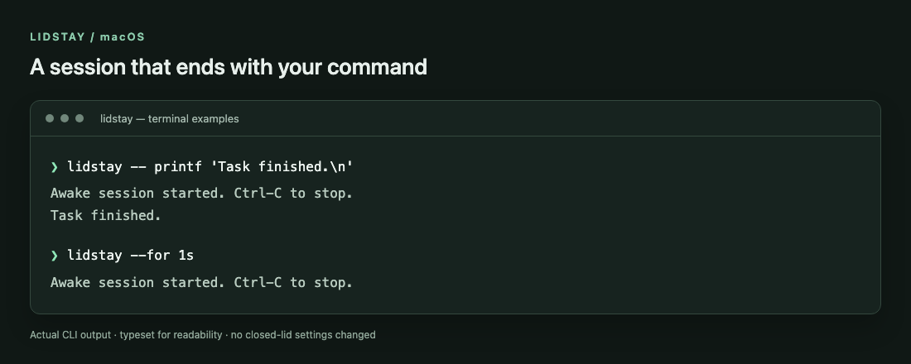
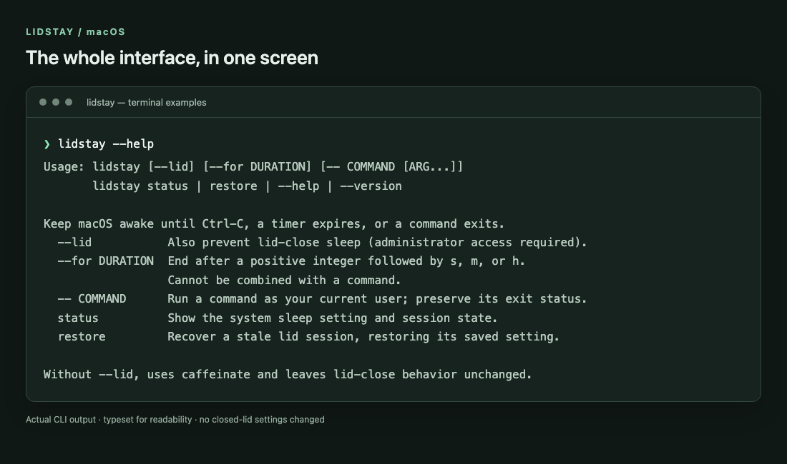

# lidstay

**Keep your Mac awake until the work is done.**

A small macOS command-line tool for long builds, coding agents, downloads, and anything else you don't want interrupted by sleep. Run it for one command, set a timer, or leave it running until you press Ctrl-C. Add `--lid` when you need a closed-lid session.

```sh
lidstay --lid -- codex
lidstay --lid --for 2h
lidstay -- npm run build
```

Built with the tools already on your Mac: Bash, `caffeinate`, and `pmset`. No extra runtime dependencies, background service, or network access from lidstay itself.

[Install](#install) · [Examples](#everyday-use) · [How it works](#how-sleep-is-handled) · [Recovery](#recover-an-interrupted-session)



*Actual output from lidstay, typeset for readability. Copyable commands are below.*

## Why this exists

An agent can work for hours. A sleeping laptop can't.

The joke is a $199 clip to keep the lid open. The useful part is wanting your Mac to stay awake while something finishes. Lidstay handles that in the terminal, with an explicit end to each session and recovery if a closed-lid session gets interrupted.

<p align="center">
  
</p>

*The meme above is a joke, not an Apple product announcement. Screenshot supplied by the project author; the visible post is credited to Peter Dedene (@dedene).*

## Install

Requires **macOS**. Closed-lid sessions also require administrator access; ordinary awake sessions do not.

```sh
git clone https://github.com/codewithriza/lidstay.git
cd lidstay
mkdir -p "$HOME/.local/bin"
install -m 755 bin/lidstay "$HOME/.local/bin/lidstay"
```

If `~/.local/bin` is not on your PATH, add this line to `~/.zshrc` and open a new terminal:

```sh
export PATH="$HOME/.local/bin:$PATH"
```

Try a short session:

```sh
lidstay --for 10s
```

It ends automatically after ten seconds. Use `lidstay --help` for the full command reference.

## Everyday use

### Keep a coding agent or build running

Put `--` before the command you want to run:

```sh
lidstay --lid -- codex
lidstay --lid -- claude
lidstay -- npm run build
lidstay -- python3 train.py
```

The session ends when the command exits. Commands run as your current user, not as root. Arguments and standard input pass through, and lidstay returns the command's exit status.

### Set a timer or stop it yourself

```sh
lidstay --for 45m          # Stay awake for 45 minutes
lidstay --lid --for 2h     # Allow a closed lid for two hours
lidstay                   # Stay awake until Ctrl-C
lidstay --lid             # Closed-lid session until Ctrl-C
```

For music, start playback in your preferred app, then run `lidstay --lid`. Stop the session with Ctrl-C when finished.

Durations use positive whole seconds (`s`), minutes (`m`), or hours (`h`), with no leading zeros and a maximum of seven days. A timer and a command cannot be combined.

Terminal interrupts stop the session. Commands that launch independent or detached processes remain responsible for those processes.

### Check the current state

```sh
lidstay status
```

This shows the system sleep setting and whether a saved lid session is active or interrupted.

<details>
<summary>See the full help output</summary>



Run `lidstay --help` to read the same reference in your terminal.

</details>

## How sleep is handled

| Mode | What changes | When it ends |
| --- | --- | --- |
| `lidstay` | Uses `caffeinate -i` to prevent idle system sleep. The display can turn off; closing the lid behaves normally. | The command exits, the timer expires, or you stop the session. |
| `lidstay --lid` | Also sets `pmset -a disablesleep 1`, a **system-wide setting that includes battery power**. | Restores the previous setting on normal exit, Ctrl-C, termination, or terminal closure. |

Only one closed-lid session can run at a time. Ordinary caffeinate sessions can overlap. If sleep was already disabled before a closed-lid session, it stays disabled afterward.

**Test a short closed-lid session on your Mac before relying on it for long-running work.** Behavior depends on the Mac and macOS version. Keep the Mac on a ventilated surface, never awake inside a bag. Battery drain continues while sleep is disabled; lidstay cannot bypass thermal shutdown or keep work running after power loss.

<details>
<summary>Saved state and administrator access</summary>

The previous sleep setting is saved in `~/Library/Application Support/lidstay/session` before it is changed.

While a closed-lid session is active, lidstay refreshes its sudo authorization once a minute so restoration can run without another password prompt. It does not modify sudoers or install a privileged helper. If restoration fails, it reports an error and keeps the recovery state.

Avoid changing the same power setting from another app during a session.

</details>

## Recover an interrupted session

A forced kill (`kill -9`), power loss, or OS failure cannot run cleanup. If a closed-lid session was interrupted:

```sh
lidstay status
lidstay restore
```

`restore` reads the saved setting and restores it after administrator authentication. Stop an active session before trying to restore it, and **do not remove the saved state before recovery**.

If you deliberately want to enable normal macOS sleep instead of restoring a previously disabled setting:

```sh
sudo pmset -a disablesleep 0
```

## Development

The executable lives in [`bin/lidstay`](bin/lidstay). To check it locally:

```sh
bash -n bin/lidstay
python3 -m unittest discover -s tests -v
```

The lifecycle tests substitute macOS commands and never change the test host's power settings. CI runs them on macOS and Linux. Python is needed only for tests.

When changing sleep behavior, keep global power-setting changes inside the saved-state lifecycle. Test both an initially enabled and an initially disabled sleep setting.

## Uninstall

Stop any active session. Check `lidstay status` and run `lidstay restore` if it reports an interrupted session. Then remove the executable:

```sh
rm "$HOME/.local/bin/lidstay"
```

## License

The code is [MIT licensed](LICENSE). The embedded meme is credited above and is not covered by the code license.
